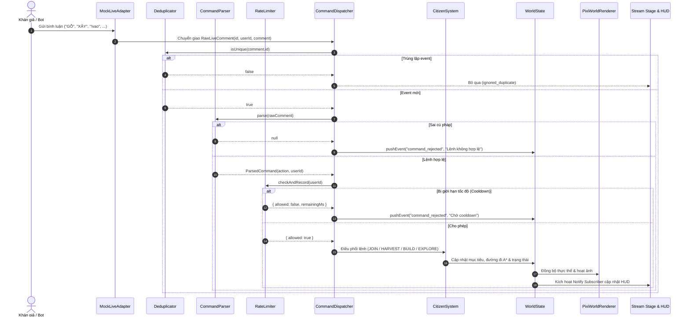
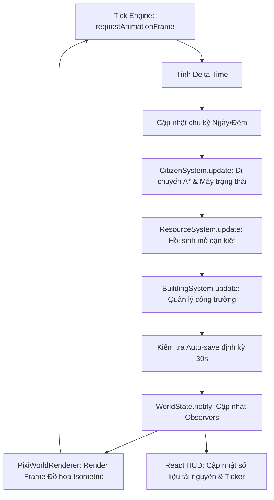
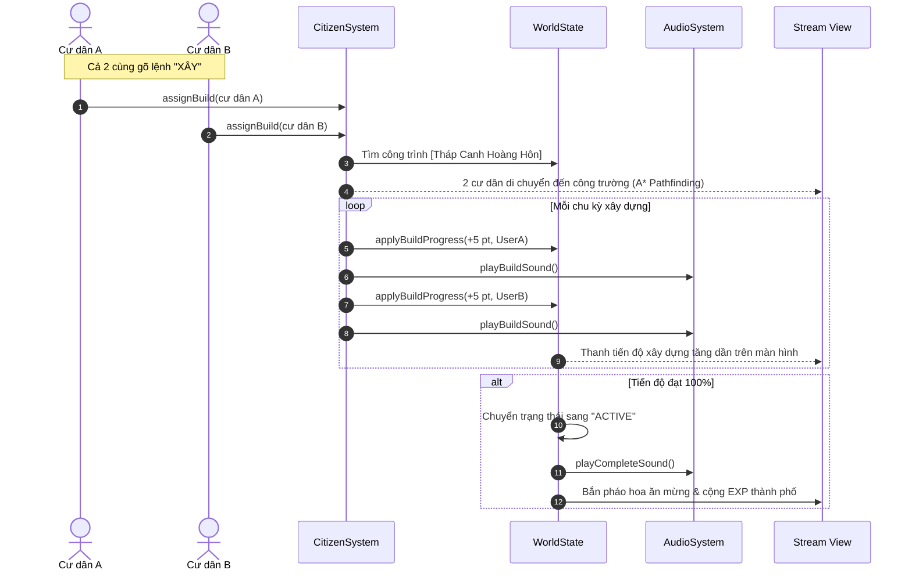

# LIVE CITY — SƠ ĐỒ LUỒNG DỮ LIỆU (DATA FLOW SPECIFICATION)
## Phase 00: Foundation & Project Engineering

Tài liệu này minh họa các luồng dữ liệu chính trong trò chơi LIVE CITY.

---

## 1. LUỒNG XỬ LÝ LỆNH TỪ BÌNH LUẬN KHÁN GIẢ (COMMENT PIPELINE)

---

## 2. VÒNG LẶP CHÍNH CỦA GAME ENGINE (GAME TICK LOOP)

---

## 3. LUỒNG TƯƠNG TÁC ĐÓNG GÓP XÂY DỰNG NHIỀU NGƯỜI (COLLABORATIVE BUILDING)

