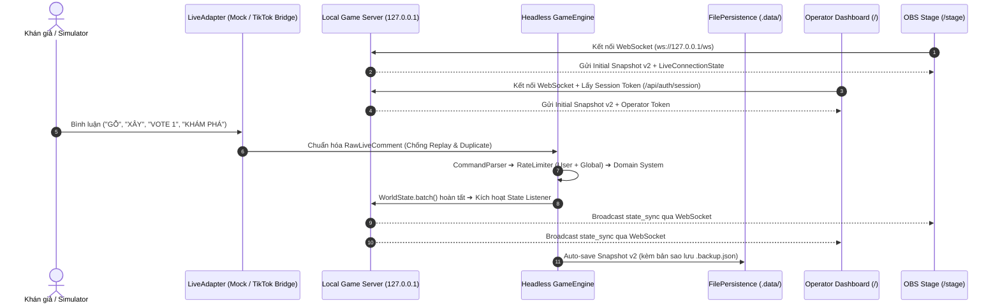
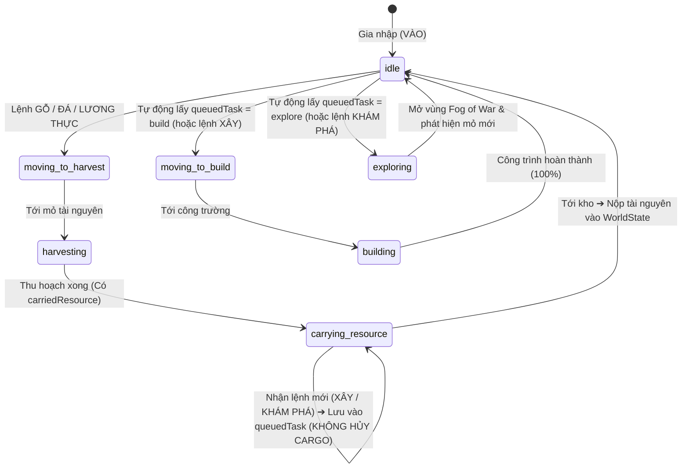
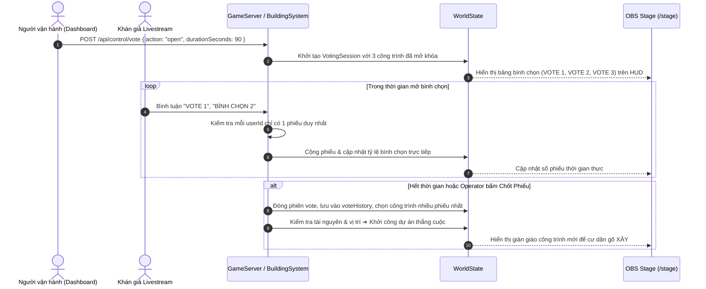

# LIVE CITY — SƠ ĐỒ LUỒNG DỮ LIỆU (DATA FLOW SPECIFICATION)

Tài liệu này mô tả luồng dữ liệu thời gian thực giữa Khán giả Livestream, Local Game Server, Operator Dashboard (`/`) và OBS Stage (`/stage`).

---

## 1. LUỒNG ĐỒNG BỘ REALTIME GIỮA SERVER, DASHBOARD VÀ OBS STAGE

---

## 2. LUỒNG BẢO TOÀN CARGO VÀ HÀNG ĐỢI NHIỆM VỤ CƯ DÂN

---

## 3. LUỒNG BIỂU QUYẾT DỰ ÁN CỘNG ĐỒNG (COMMUNITY VOTING FLOW)

